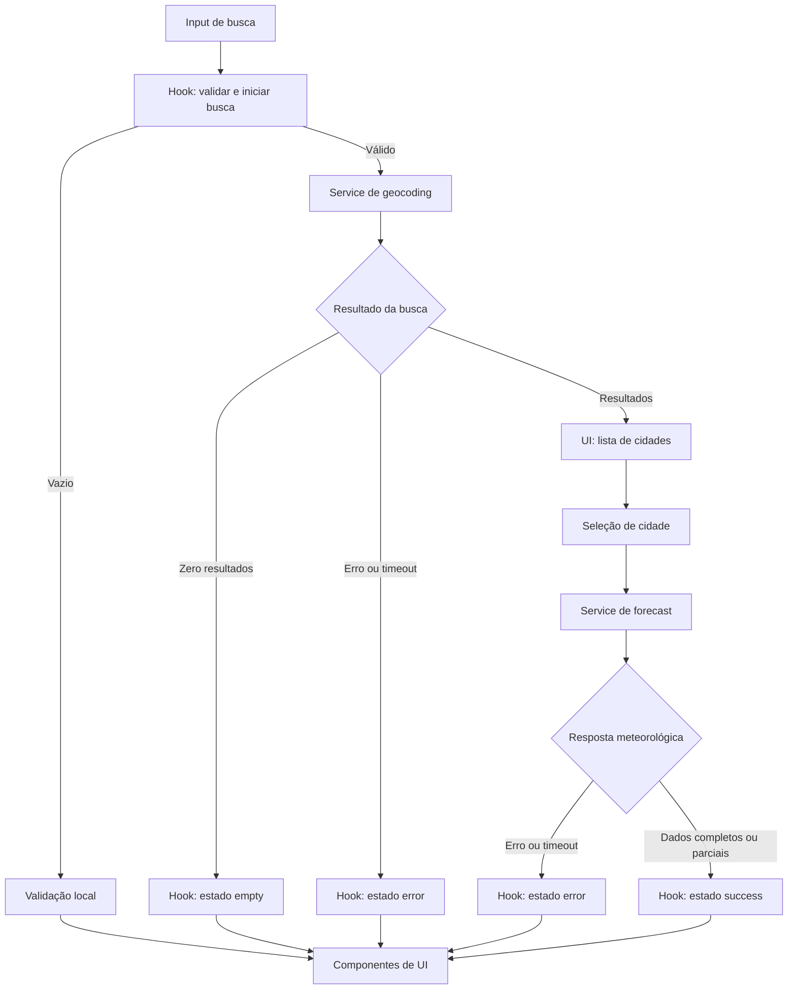

# Plano Técnico — Weather App

## Architecture

- **SPA client-side, sem backend.** React/Vite serve a interface; o navegador consulta diretamente o Open-Meteo, que não exige chave de API.
- **Camadas:** apresentação em `src/components/`, orquestração e estado em `src/hooks/`, I/O HTTP em `src/services/`, contratos em `src/types/` e transformações puras em `src/lib/`. Componentes e hooks não chamam `fetch`; serviços não contêm regras de apresentação.
- **Uma consulta meteorológica por localização.** O endpoint de previsão retorna clima atual e previsão diária; pedir ambos na mesma requisição reduz chamadas e evita estados inconsistentes entre endpoints.
- **Dados efêmeros.** Resultados, localização selecionada e unidade ficam em memória durante a sessão. Não usar cache persistente, armazenamento local, backend ou biblioteca de estado/cache externa.
- **Proteção contra respostas obsoletas.** Cancelar a busca ou consulta anterior com `AbortController` ao iniciar outra e validar um identificador sequencial antes de aplicar qualquer resposta.
- **Validação na fronteira.** Converter a resposta externa para os tipos de domínio e validar campos, datas, códigos WMO e fuso antes de atualizar a interface.

## Tech Stack

- TypeScript 6 em modo `strict`; React 19 e React DOM; Vite 8.
- Tailwind CSS 3.4 para estilos, seguindo o tema dark glassmorphism definido pelo projeto.
- `fetch` nativo e `URLSearchParams` para chamadas HTTP; nenhuma chave ou segredo no cliente.
- Estado React local (`useReducer` no hook principal); sem router, cliente de dados ou biblioteca de estado adicional para este MVP de página única.
- Vitest 4, Testing Library, `user-event` e jsdom para testes unitários/de componentes; Playwright 1.61 para E2E.
- Biome 2.5 para lint e formatação; pnpm 11.8 e Node.js 22 ou superior.

## Project Structure

Estrutura proposta; o repositório ainda não contém `src/` nem `tests/`.

```text
src/
  App.tsx
  main.tsx
  components/
    CitySearch.tsx
    LocationResults.tsx
    CurrentWeather.tsx
    ForecastList.tsx
    UnitToggle.tsx
    QueryStatus.tsx
  hooks/
    useWeatherApp.ts
  services/
    openMeteoClient.ts
  types/
    weather.ts
  lib/
    openMeteoMapper.ts
    temperature.ts
    weatherConditions.ts
tests/
  setup.ts
  unit/
    components/
    hooks/
    services/
    lib/
  e2e/
    weather-app.spec.ts
```

Responsabilidades: `components/` renderiza props e emite eventos, sem acessar rede ou converter dados; `hooks/` mantém o reducer e coordena as operações dos serviços; `services/` constrói chamadas HTTP, aplica timeout e classifica respostas; `lib/` contém normalização/mapeamento, conversões e regras puras; `types/` define os contratos compartilhados. Essa direção permite testar a UI com serviços simulados, o hook com serviços injetados e cada função de `lib/` sem React, DOM ou rede. A configuração Vitest já inclui `tests/unit/**/*`; E2E usa o diretório configurado em `playwright.config.ts`.

## Data Model

Os contratos abaixo são modelos de domínio, não cópias do JSON do provedor. Valores meteorológicos são normalizados em Celsius; conversão e arredondamento acontecem na apresentação.

```ts
export type Unit = 'celsius' | 'fahrenheit';

export interface City {
  id: string; // ID Open-Meteo convertido em texto ou chave derivada das coordenadas.
  name: string; // Nome da cidade retornado pela geocodificação.
  adminRegion: string | null; // Região administrativa, quando disponível.
  country: string | null; // País, quando disponível.
  latitude: number; // Latitude usada nas consultas meteorológicas.
  longitude: number; // Longitude usada nas consultas meteorológicas.
}

export interface CurrentWeather {
  temperatureC: number | null; // Valor de current.temperature_2m normalizado para Celsius.
  weatherCode: number | null; // Código WMO recebido em current.weather_code.
  conditionLabelPtBR: string | null; // Rótulo pt-BR mapeado do código WMO.
  observedAt: string | null; // Horário local recebido em current.time, interpretado com timezone.
}

export type ForecastAvailability = 'complete' | 'partial' | 'unavailable';

export interface ForecastDay {
  dateLocal: string; // Data de daily.time em YYYY-MM-DD no fuso da cidade.
  weatherCode: number | null; // Código WMO recebido em daily.weather_code.
  conditionLabelPtBR: string | null; // Rótulo pt-BR mapeado do código WMO.
  minTemperatureC: number | null; // Valor de daily.temperature_2m_min normalizado para Celsius.
  maxTemperatureC: number | null; // Valor de daily.temperature_2m_max normalizado para Celsius.
  availability: ForecastAvailability; // Indica se os campos do dia estão completos, parciais ou ausentes.
}

export interface WeatherData {
  city: City; // Localização selecionada para a consulta.
  timezone: string | null; // Identificador IANA retornado em timezone.
  current: CurrentWeather; // Dados atuais normalizados do objeto current.
  forecast: ForecastDay[]; // Cinco datas locais ordenadas, inclusive dias indisponíveis.
}

export type QueryState<T> =
  | { status: 'idle'; data: null; error: null }
  | { status: 'loading'; data: null; error: null }
  | { status: 'success'; data: T; error: null }
  | { status: 'empty'; data: null; error: null }
  | { status: 'error'; data: null; error: AppError };

export type AppErrorKind =
  | 'network'
  | 'timeout'
  | 'http'
  | 'invalid-response';

export interface AppError {
  kind: AppErrorKind;
  message: string; // mensagem pt-BR segura para a interface
  httpStatus?: number; // Status HTTP quando o provedor respondeu com erro.
  retryable: boolean; // Se FR-07 permite nova tentativa manual.
  retryAfterMs?: number; // Espera derivada do cabeçalho Retry-After, quando presente.
}

export interface WeatherService {
  searchLocations(query: string, signal: AbortSignal): Promise<City[]>;
  getWeather(city: City, signal: AbortSignal): Promise<WeatherData>;
}
```

Regras do modelo:

- `City.id` usa o identificador do provedor; se ausente, deriva de latitude/longitude. Coordenadas mantêm a precisão recebida para as consultas; o arredondamento visual serve apenas à desambiguação.
- `observedAt` preserva o horário local recebido. `timezone` é o identificador IANA retornado pelo provedor; sem ele, o clima atual pode ser exibido sem horário local e a previsão fica indisponível conforme AC-04.4.
- `forecast` sempre contém as cinco datas esperadas. Datas/valores ausentes são representados como indisponíveis, nunca como zero.
- Códigos WMO são mapeados exatamente pela tabela da spec; código desconhecido produz condição indisponível.
- A UI calcula °C/°F a partir de Celsius não arredondado e arredonda o resultado final para uma casa decimal.

## Data Flow

1. O usuário envia o nome da cidade. Normalizar apenas espaços periféricos; entrada vazia gera validação local e não faz chamada.
2. `useWeatherApp` inicia geocodificação com `searchLocations`. Resultados são normalizados e apresentados; zero resultados produzem estado vazio, sem consulta meteorológica.
3. O usuário seleciona um resultado. Limpar os dados da localização anterior, mostrar a localização nova e iniciar `getWeather` com as coordenadas exatas selecionadas.
4. `getWeather` solicita clima atual e dados diários em uma chamada. O normalizador valida a resposta, resolve as cinco datas locais no fuso retornado e completa datas ausentes como indisponíveis.
5. A UI aplica a unidade de sessão e os rótulos WMO pt-BR. A troca de unidade não faz nova chamada.
6. Em seleção/busca subsequente, abortar a chamada anterior e ignorar toda resposta cujo identificador não seja o da operação ativa.
7. Em falha transitória, preservar parâmetros para retry manual; não persistir dados após encerrar a sessão.



## External APIs

### Open-Meteo Geocoding

- `GET https://geocoding-api.open-meteo.com/v1/search`
- Parâmetros: `name` com o termo normalizado, `language=pt` e `format=json`. `count` pode ser omitido para usar o padrão do provedor; não filtrar nem reordenar resultados na aplicação.
- Construir a query com `URLSearchParams`; não remover acentos nem caracteres do nome além de espaços periféricos.
- Resposta resumida:

```json
{
  "results": [
    {
      "id": 3448439,
      "name": "São Paulo",
      "latitude": -23.55,
      "longitude": -46.63,
      "admin1": "São Paulo",
      "country": "Brazil",
      "country_code": "BR"
    }
  ]
}
```

- Mapeamento: `results[].id` para `City.id` como texto; `name` para `name`; `admin1` para `adminRegion`; `country` para `country`; `latitude`/`longitude` para os campos homônimos. Campo ausente vira `null`; sem resultados (array ausente ou vazio) vira `[]`.
- `country_code` não é necessário no modelo atual e pode ser descartado. Contexto ausente é exibido conforme AC-02.1.

### Open-Meteo Forecast

- `GET https://api.open-meteo.com/v1/forecast`
- Parâmetros: `latitude`, `longitude`, `current=temperature_2m,weather_code`, `daily=weather_code,temperature_2m_max,temperature_2m_min`, `timezone=auto`, `forecast_days=5`, `temperature_unit=celsius`.
- `current` solicita os campos do clima atual; `daily` solicita condição e máximas/mínimas; `timezone=auto` faz o provedor calcular datas no fuso das coordenadas. Celsius é solicitado para manter um único valor-base no domínio.
- Resposta resumida:

```json
{
  "latitude": -23.55,
  "longitude": -46.63,
  "timezone": "America/Sao_Paulo",
  "current": {
    "time": "2026-11-11T09:00",
    "temperature_2m": 18.2,
    "weather_code": 1
  },
  "daily": {
    "time": ["2026-11-11", "2026-11-12", "2026-11-13", "2026-11-14", "2026-11-15"],
    "weather_code": [1, 2, 3, 61, 0],
    "temperature_2m_max": [23.1, 24.0, 20.5, 19.2, 22.0],
    "temperature_2m_min": [16.0, 17.1, 15.4, 14.8, 16.3]
  }
}
```

- Mapeamento: `timezone` para `WeatherData.timezone`; `current.temperature_2m`, `current.weather_code` e `current.time` para `CurrentWeather.temperatureC`, `weatherCode` e `observedAt`; cada índice dos arrays `daily` forma um `ForecastDay`, usando `time` como `dateLocal`, `weather_code` como `weatherCode` e `temperature_2m_min/max` como `min/maxTemperatureC`. `conditionLabelPtBR` vem da tabela WMO da spec, não da API. `availability` é `complete` quando código e ambas as temperaturas estão presentes, `partial` quando apenas parte desses campos existe e `unavailable` quando todos estão ausentes.
- Arrays diários são paralelos e associados pelo mesmo índice. Validar tipos, comprimentos e fuso antes de normalizar; produzir exatamente cinco dias e marcar valores ausentes como indisponíveis. Sem fuso válido, marcar a previsão indisponível e ainda exibir dados atuais válidos.
- Sem API key. Verificar limites, cobertura, termos e atribuição exigida no release gate da spec.

A construção de URLs e o transporte ficam isolados em `openMeteoClient.ts`; somente esse serviço e `lib/openMeteoMapper.ts` conhecem o formato JSON externo. O mapper recebe objetos já decodificados e não realiza I/O.

## State Management

O estado da aplicação vive em um único `useReducer` encapsulado por `useWeatherApp`; componentes recebem dados e callbacks, sem estado global ou acesso direto aos serviços. O estado inclui termo/validação da busca, `searchState: QueryState<City[]>`, `selectedCity`, `weatherState: QueryState<WeatherData>` e `unit: Unit`.

Estados por consulta:

- `idle`: nenhuma requisição iniciada; estado inicial de busca e clima.
- `loading`: requisição em andamento; `data` e `error` são nulos.
- `success`: resposta utilizável; contém dados. Resposta parcial continua em `success`, com campos nulos e `ForecastDay.availability` indicando completude.
- `empty`: somente busca concluída com zero cidades; não dispara consulta meteorológica.
- `error`: falha de rede, timeout, HTTP não recuperável ou resposta inválida; contém `AppError` e não contém dados antigos.

Transições são disparadas por ações explícitas do reducer (`searchStarted/Resolved/Empty/Failed`, `citySelected`, `weatherStarted/Resolved/Failed`, `unitChanged`). Manter `AbortController` e identificadores de requisição em refs do hook, fora do estado renderizável: nova busca/cidade cancela a anterior e respostas obsoletas são ignoradas. Cancelamento por substituição é silencioso; timeout é erro após 10 segundos.

`unit` começa em `celsius` e permanece apenas em memória durante a sessão. `CurrentWeather` e `ForecastDay` guardam valores canônicos em Celsius. Na renderização, funções puras de `lib/temperature.ts` derivam Celsius ou Fahrenheit para temperatura atual e mínima/máxima; arredondar a uma casa decimal somente no formato apresentado. Alterar a unidade despacha `unitChanged`, não modifica os dados e não inicia request. Ao iniciar nova sessão, a unidade volta a Celsius.

## Error Handling

- **Entrada inválida:** validação local ligada ao campo; manter a consulta em `idle`, não chamar a API e não oferecer retry.
- **Geocoding sem resultados:** HTTP bem-sucedido com lista vazia vira `searchState.status = 'empty'`; manter o termo, permitir editar/buscar novamente e não consultar forecast.
- **Falha de rede:** classificar como `network`, limpar dados da operação substituída, mostrar mensagem pt-BR e permitir retry manual com os mesmos parâmetros.
- **Erro HTTP:** 429 e 5xx são recuperáveis por retry manual. Para 429, interpretar `Retry-After` como segundos ou data HTTP e bloquear a ação até esse instante; sem cabeçalho, permitir retry imediato. Outros 4xx exibem erro pt-BR sem retry.
- **Timeout:** após 10 segundos, cancelar com `AbortController`, definir `kind: 'timeout'` e oferecer retry manual. Abort causado por nova ação não é erro visível nem retry.
- **Resposta inválida:** falha de parsing/validação vira `invalid-response`; não expor payload ou mensagem técnica e não oferecer retry, pois repetir a mesma resposta não corrige o contrato.
- **Resposta parcial:** não vira `error`. Manter `success`, renderizar campos/dias disponíveis e marcar os demais como indisponíveis; nunca substituir ausências por zero nem por dados da cidade anterior. Fuso ausente invalida a previsão, mas não descarta clima atual válido.
- **Acessibilidade:** estados de carregamento usam status acessível; falhas usam alerta em pt-BR, sem mover o foco.

## Testing Strategy

- **Vitest — `tests/unit/lib`:** testar conversão Celsius/Fahrenheit, arredondamento a uma casa decimal, valores ausentes, todos os códigos WMO da tabela e códigos desconhecidos, normalização dos payloads e geração das cinco datas locais. Usar testes parametrizados, fixtures e relógio controlado; nenhuma função pura deve depender de React, DOM ou rede.
- **Vitest — `tests/unit/services`:** substituir `fetch` por mock e verificar URL, parâmetros, codificação de acentos, `current`, `daily`, `timezone`, normalização e classificação de respostas HTTP. Cobrir rede, 4xx, 429 com/sem `Retry-After`, 5xx, JSON inválido, timeout de 10 s, cancelamento e resposta parcial; não chamar Open-Meteo real.
- **Vitest — `tests/unit/components`:** com Testing Library e `user-event`, testar cada componente nos estados aplicáveis: `idle`, `loading`, `success`, `empty` e `error`; verificar dados parciais, nomes acessíveis, navegação por teclado, anúncio de status/alerta, seleção de cidades homônimas e unidade exibida.
- **Vitest — `tests/unit/hooks`:** injetar serviços substituíveis e promises controladas para validar transições do reducer, retry, mudança de unidade sem nova chamada e descarte de respostas tardias de busca ou cidade.
- **Playwright — E2E:** interceptar as duas rotas Open-Meteo para manter os fluxos determinísticos. Cobrir busca → seleção → clima atual/previsão → alternância de unidade, além de vazio, erro, retry e concorrência. Verificar que mudar unidade não dispara novo request meteorológico.
- **Playwright — viewport mobile:** executar o fluxo principal no projeto de dispositivo iPhone configurado e um cenário em viewport mínimo de 320 CSS px; validar ausência de rolagem horizontal, conteúdo legível, alvos de toque operáveis e controles principais. Manter um projeto desktop Chromium. Firefox e Safari/WebKit ficam na matriz de compatibilidade de release conforme NFR-01.
- **Release:** executar `pnpm lint`, `pnpm build`, `pnpm test` e `pnpm test:e2e`; validar manualmente WCAG 2.2 AA e os SLOs da spec. Testes de desempenho usam provedor respondendo em até 4 s, RTT de 100 ms e largura de banda de 10 Mbps.

## Risks & Trade-offs

| Decisão | Alternativa considerada e trade-off |
|---|---|
| Consultar Open-Meteo diretamente do navegador, sem backend. | Um proxy/backend permitiria cache e isolamento do provedor, mas adicionaria implantação e operação sem necessidade de chave, conta ou persistência neste MVP. A dependência externa e os limites do provedor permanecem riscos. |
| Pedir clima atual e previsão na mesma chamada Forecast. | Endpoints separados permitiriam falhas independentes, mas aumentariam chamadas e risco de horários inconsistentes. Uma resposta única simplifica o estado; dados parciais continuam representáveis. |
| Usar `useReducer` local, sem biblioteca de estado/cache. | Redux ou TanStack Query ofereceriam ferramentas de cache e deduplicação, mas ampliariam dependências e comportamento além do necessário para uma SPA com estado efêmero. |
| Manter temperaturas canônicas em Celsius e converter durante a renderização. | Solicitar novamente ao provedor ao trocar unidade poderia usar seus arredondamentos, mas causaria latência, falhas adicionais e requests sem necessidade. Conversão local atende à fórmula e à precisão da spec. |
| Não persistir nem manter cache de dados. | Cache melhoraria consultas repetidas e resiliência offline, mas poderia exibir dados desatualizados e contrariaria as decisões de privacidade/escopo do MVP. Cada seleção depende da rede e mostra o horário fornecido pela fonte. |
| Mockar APIs nos testes automatizados. | Testes E2E contra o serviço real validariam a integração externa, mas seriam instáveis e sujeitos a indisponibilidade/limites. Usar mocks nos testes e confirmar termos, cobertura e payload real nos gates de release. |
| E2E principal em Chromium desktop e dispositivo mobile; matriz restante no release gate. | Executar toda a suíte em todos os navegadores aumentaria tempo de CI; a matriz ampliada continua necessária para validar a NFR-01, mas não precisa duplicar cada cenário. |
